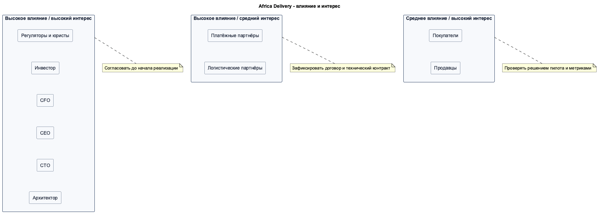

# Матрица стейкхолдеров

## Приоритет решений

При конфликте применяется порядок:

1. Закон и требования регулятора.
2. Инвестор - цели бизнеса, дата запуска, допустимый риск.
3. CFO - бюджет, ликвидность и правила закупки.
4. CEO - приоритет продукта и работа на местном рынке.
5. CTO - техническая реализация в утверждённых границах.
6. Архитектор - согласованность решения и фиксация последствий.
7. Партнёры - ограничения внешних интерфейсов и договоров.

| Стейкхолдер | Интерес | Влияние | Приоритет при конфликте | Способ общения |
| --- | --- | --- | --- | --- |
| Государственные регуляторы и местные юристы | Законность обработки данных, платежей, рекламы и контента | Критическое | 1 | Письменное заключение, реестр требований, контрольные даты |
| Инвестор | Запуск 15 октября, рост рынка, отсутствие заметных простоев, низкая цена | Критическое | 2 | Короткое решение с цифрами, риском и вариантом возврата |
| CFO Анна Вебер | Инфраструктура до $5 000 в месяц, шесть контракторов, отсутствие долгих обязательств | Высокое | 3 | TCO, стоимость заказа, коммерческие предложения и пороги согласования |
| CEO Мари Лефевр | Работающий MVP, позиционирование и выход в новые страны | Высокое | 4 | Еженедельный обзор объёма MVP, метрик запуска и решений по приоритетам |
| CTO Раджеш Менон | Go, Cloud Native, масштабирование, самостоятельная разработка логистики | Высокое | 5 | ADR с альтернативами, расчётом затрат и условиями пересмотра |
| Архитектор | Целостность решения, обратимость, прослеживаемость требований | Высокое | 6 | Реестр решений, ADR, диаграммы и список открытых вопросов |
| Покупатели | Низкая цена, работа при слабой сети, понятная оплата и получение заказа | Среднее | 7 | Исследования, поддержка, метрики ошибок и времени оформления |
| Продавцы | Простая регистрация, управление товарами, выплаты в срок | Среднее | 7 | Пилот со 100 продавцами, WhatsApp, обучение и поддержка |
| Платёжные партнёры | Соблюдение договора, KYC, корректная обработка повторов | Высокое | 7 | Технический канал, сверка операций и договорный SLA |
| Логистические партнёры | Корректные заявки, адресные данные и статусы доставки | Среднее | 7 | Технический канал, журнал ошибок и ежедневная сверка |

## Работа с группами

- Высокое влияние и высокий интерес: регуляторы, инвестор, CFO, CEO и CTO. Решения согласуются до начала работы.
- Высокое влияние и средний интерес: платёжные и логистические партнёры. Для них фиксируются договор и технический контракт.
- Среднее влияние и высокий интерес: покупатели и продавцы. Решение проверяется пилотом и наблюдаемыми метриками.

## Допущения

- Инвестор принимает окончательное бизнес-решение после обязательных требований закона.
- CFO может остановить статью затрат, которая нарушает установленный бюджет.
- Уволившийся менеджер продукта не участвует в принятии решений. Его список используется как источник пожеланий.

