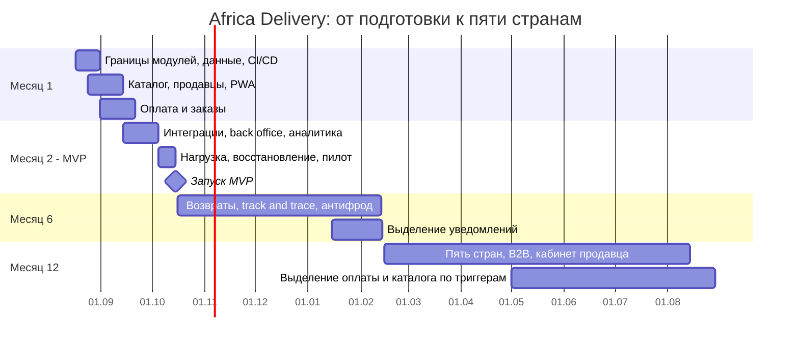

# Roadmap

## Отбор объёма

В MVP входят 6 из 29 пунктов Product Manager: каталог; WhatsApp-онбординг продавца; оплата; PWA; базовый back office; панель CEO. Оплата сужена до M-Pesa и Flutterwave, PWA не дублируется нативными приложениями, back office закрывает только каталог и исключения. Остальные 23 пункта отложены.

Критерий: функция входит в MVP, если без неё нельзя пройти путь `товар -> заказ -> оплата -> передача в доставку`, выполнить известное требование закона или измерить пилот. Голосовой поиск, рекомендации, стримы, кредит, кошелёк, криптолояльность, игры, динамические цены, видеофиксация, ML-антифрод, B2B, публичный GraphQL, три клиента и тёмная тема этот критерий не проходят.

| Контрольная точка | Объём | Команда | Инфраструктура |
| --- | --- | --- | ---: |
| Месяц 1 | скелет модулей, каталог, профиль страны, первая оплата в песочнице | 4 разработчика, DevOps/SRE, тестировщик | до $2 500/мес |
| Месяц 2 | 6 пунктов MVP, Нигерия + Кения, 5 000 SKU, 100 продавцов | те же 6 контракторов | $4 100/мес |
| Месяц 6 | возвраты, полное отслеживание, правила антифрода, стабильные SLO | продуктовая группа + локальный операционный владелец | до $7 000/мес после одобрения CFO |
| Месяц 12 | пять стран, B2B, кабинет продавца, локализация языков | 2 группы по бизнес-областям и общая платформа | по фактической нагрузке, целевой предел $12 000/мес |

## Первые восемь недель

- Неделя 1: коммерческие предложения, юридические допущения, метрики пилота, окружения.
- Недели 2-3: каталог, продавцы, профиль страны, PWA.
- Недели 4-5: заказ, M-Pesa, Flutterwave, идемпотентность, уведомления.
- Неделя 6: back office, аналитика, логистика партнёров.
- Неделя 7: нагрузка, безопасность, восстановление, обучение операций.
- Неделя 8: исправления, ограниченный пилот, постепенное открытие трафика.

## Команда и дежурство

Шесть контракторов работают удалённо, потому что найм и переезд в Найроби за восемь недель увеличат риск. На старте: 2 разработчика ядра, разработчик PWA, разработчик интеграций, DevOps/SRE и тестировщик с автоматизацией. CTO принимает архитектуру, CEO владеет продуктовым приоритетом, местный операционный специалист привлекается как партнёр до разрешения найма.

Круглосуточное дежурство не означает непрерывную смену из шести человек. Вне рабочего времени один инженер принимает только критические события оплаты и потери данных; второй доступен для усиления. Ротация - по неделе, не чаще одного дежурства в три недели, с отгулом после ночного инцидента. Уведомления и аналитика ждут рабочего времени.

Встреча в Найроби нужна в первую неделю для согласования объёма, провайдеров и юридических допущений. После этого ежедневная разработка остаётся удалённой, а очные встречи проводятся на контрольных точках запуска страны.

## Допущения

- Дата MVP - 15 октября 2026 года.
- Рост бюджета после месяца 2 требует отдельного решения CFO.
